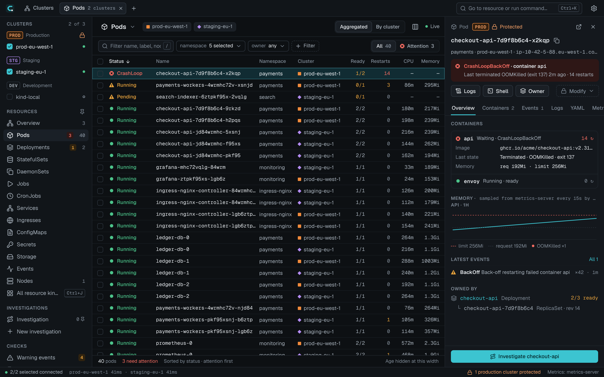
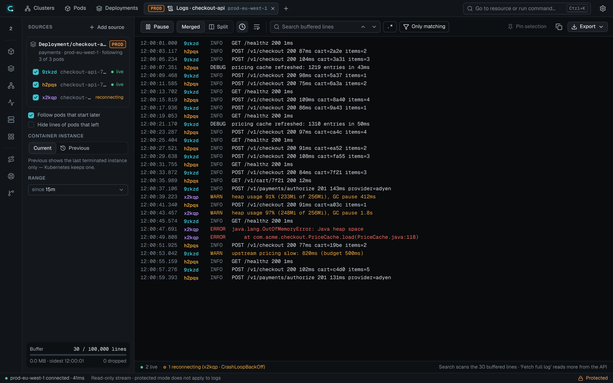
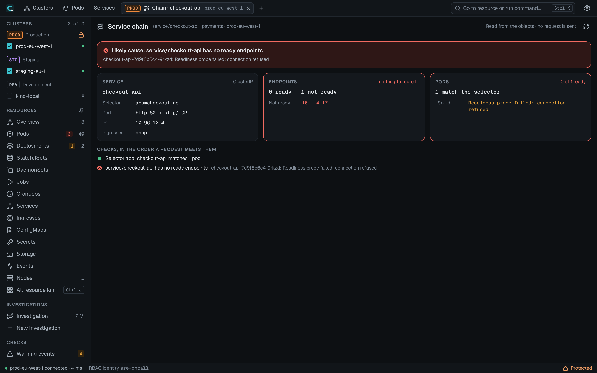
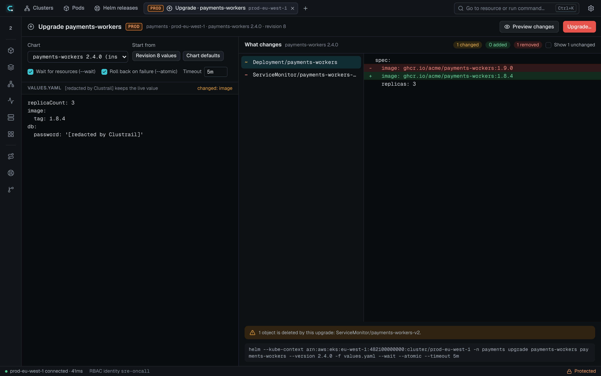
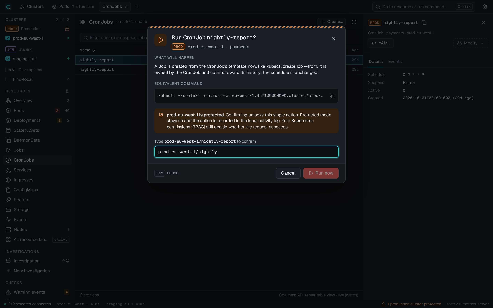
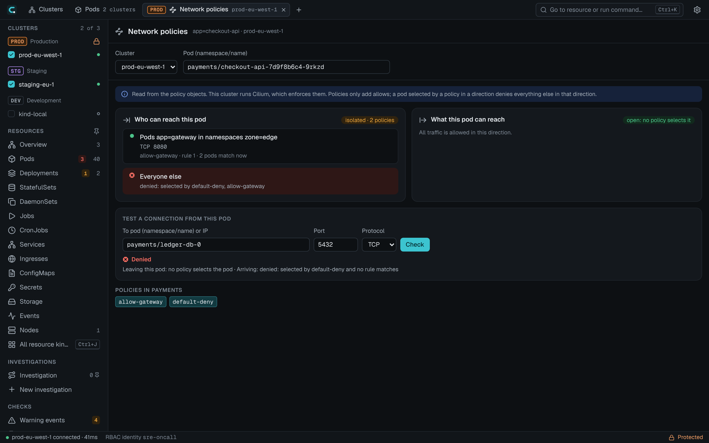
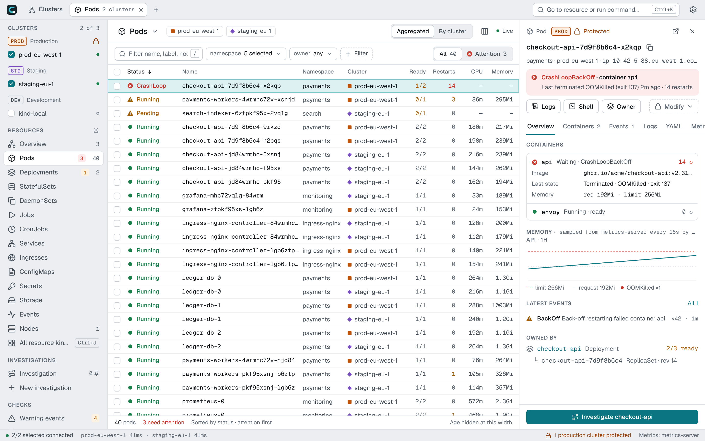

<p align="center">
  
</p>

<h1 align="center">Clustrail</h1>

<p align="center">
  A free, open-source Kubernetes desktop workspace for many clusters, with production safety built in.<br>
  macOS · Windows · Linux · English and Turkish
</p>

<p align="center">
  <a href="https://clustrail.mihnk.org">Website</a> ·
  <a href="docs/development.md">Build from source</a> ·
  <a href="docs/architecture/backend.md">How it works</a> ·
  <a href="CONTRIBUTING.md">Contributing</a>
</p>



Clustrail connects to your clusters with the kubeconfig you already have. It
needs no in-cluster agent, no account and no SaaS backend, and it sends no
telemetry.

> **Status:** early development, no public release yet. Build it from source
> with the steps below; opened in a plain browser, the UI runs on mock data.

## What it does

- **Many clusters as one.** Pick clusters once; Pods, Deployments, Nodes and
  every other kind list them together, problems first, live over watches.
- **Production stays protected.** Each context is Standard, Protected or
  Read-only. Protected changes show their impact and the equivalent `kubectl`
  command and need the name typed; Read-only is enforced in the Go backend.
- **Finds the cause.** Logs from every pod of a workload in one stream, a
  service chain from Ingress to pods that names the first broken link, network
  policies of a pod with a connection check, Warning events, expiring
  certificates and an RBAC access matrix.
- **Everyday operations.** Shells and debug containers, node shells, port
  forwards, YAML with server-side dry run, scale, restart, rollback, cordon and
  drain through the Eviction API, Helm upgrades with a diff before they run,
  Argo CD and Flux status.
- **Fast with large clusters.** Virtualized tables, coalesced pod streams and
  bounded buffers; measured in [docs/benchmarks](docs/benchmarks/m0-results.md).

## A closer look

| | |
|---|---|
|  |  |
| **Logs** from every pod of a Deployment, merged, with pods that start later joining the stream. | **Service chain**: Ingress → Service → endpoints → pods, read from the objects, with the likely cause. |
|  |  |
| **Helm upgrade** with a server-side dry run diffed object by object; Secret values stay hidden. | **Protected contexts** ask for the name and show the `kubectl` command before anything runs. |
|  |  |
| **Network policies** of a pod, and whether one connection is allowed and by which rule. | Dark and **light** themes. |

The screenshots use sample data; [docs/development.md](docs/development.md#screenshots)
has the command that takes them.

## Build and run

Requirements: Go 1.26+ and Node 22+; on Linux also the GTK 4 and WebKitGTK 6
development packages (`sudo apt install libgtk-4-dev libwebkitgtk-6.0-dev`).

```bash
cd frontend && npm install && npm run build && cd ..
```

```bash
go build -tags production -o bin/clustrail . && bin/clustrail
```

Development with hot reload, tests, benchmarks, a local kind cluster to try it
against and the release process are in [docs/development.md](docs/development.md).

## Documentation

- [How it works](docs/architecture/backend.md): the Go backend file by file,
  the stack and the source layout.
- [Performance architecture](docs/architecture/performance.md) and
  [benchmark results](docs/benchmarks/m0-results.md).
- [Development](docs/development.md): running, testing, synthetic clusters,
  screenshots and releases.
- [Website source](website/README.md).

## License

Apache License 2.0, see [LICENSE](LICENSE). Contributions are welcome, see
[CONTRIBUTING.md](CONTRIBUTING.md).
